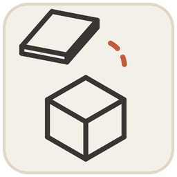

<p align="center"></p>

# Pnevma Package Manager

Design box-with-lid packaging and send it straight to LightBurn. The pieces arrive at their real size, already on their
own layers. Put a logo or a repeating pattern on the lid, and see how many boxes fit on the board you buy.

- Windows 10 (version 1809) or Windows 11, 64-bit.
- Closed source. This repository holds only the downloads and the licence.

## Download

**[Latest release](https://github.com/pan7266/Pnevma-Package-Generator/releases/latest)**

Version 0.1.0 is the first public build.

## Install

1. Download `Pnevma-Package-Manager-0.1.0-win-x64.zip` from the release.
2. Right-click the zip, choose **Extract All…**, and pick a folder you keep, such as `Documents`. Don't run the app
   from inside the zip.
3. Open the `Pnevma Package Manager` folder and run `Pnevma.PackageGenerator.exe`.
4. The app is not code-signed yet, so Windows may say **"Windows protected your PC"**. Click **More info**, then
   **Run anyway**.

There is nothing else to install: the app brings its own .NET and Windows App SDK.

## First start: sign in and get a licence

1. Click **Continue with email**, or **New to Pnevma? Create an account** the first time. You sign in in your
   browser, on the Pnevma Tools page; the app never sees your password.
2. If your account has no licence yet, the app says so and opens **Contact us**. Send the message. It already holds
   your computer code, which we need to set up your licence.
3. When we tell you the licence is ready, click **Try again**.

Good to know:
- A licence works on **one computer**. To move it to a new computer, write to us and we free the seat.
- The app keeps working **offline for up to 7 days** after it last reached the licence server.
- Your settings and logos are in `%LOCALAPPDATA%\Pnevma\PackageGenerator`. To remove the app, delete its folder, and
  that one too if you want your settings gone.

## Check the download (optional)

Compare the zip's fingerprint with `SHA256SUMS.txt` in the release. In PowerShell, in the folder with the zip:

```powershell
Get-FileHash .\Pnevma-Package-Manager-0.1.0-win-x64.zip -Algorithm SHA256
```

## Support

info@pnevmagifts.gr

## Licence

Proprietary. See [LICENSE.txt](LICENSE.txt). Copying, redistributing, reverse engineering and using the software for
AI training are not allowed.

---

## Ελληνικά

Το **Pnevma Package Manager** σχεδιάζει κουτιά με καπάκι και τα στέλνει κατευθείαν στο LightBurn, σε πραγματικό
μέγεθος και σε έτοιμα layers.

1. Κατεβάστε το zip από την **[τελευταία έκδοση](https://github.com/pan7266/Pnevma-Package-Generator/releases/latest)**.
   Κάντε δεξί κλικ → **Εξαγωγή όλων…** και ανοίξτε το `Pnevma.PackageGenerator.exe` από τον φάκελο.
2. Αν τα Windows δείξουν «Τα Windows προστάτευσαν τον υπολογιστή σας», πατήστε **Περισσότερες πληροφορίες** και μετά
   **Εκτέλεση οπωσδήποτε**.
3. Η πρώτη οθόνη είναι στα αγγλικά. Πατήστε **Continue with email** (ή **Create an account** την πρώτη φορά) και
   συνδεθείτε στον browser.
4. Αν δεν έχετε ακόμη άδεια, στείλτε μας το μήνυμα από το **Contact us**. Περιέχει ήδη τον κωδικό του υπολογιστή σας.
5. Όταν σας ενημερώσουμε, πατήστε **Try again**. Μετά, από **Settings → Language / Γλώσσα** επιλέξτε Ελληνικά.

Μία άδεια = ένας υπολογιστής. Επικοινωνία: info@pnevmagifts.gr
